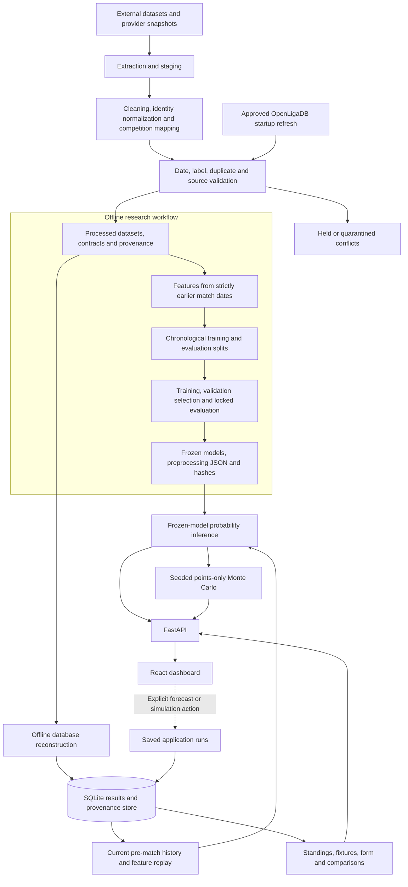

# FootIQ

### Football Data Engineering, Analytics & Machine Learning Platform

FootIQ connects traceable football data ingestion, statistical analysis and frozen machine-learning models in a local web application. A FastAPI backend serves a SQLite match store and scikit-learn predictions to a responsive React dashboard. Users can explore results and fixtures, compare teams, request match probabilities and simulate the remaining points in a domestic league season.

**Six active competitions · 90-minute Home/Draw/Away predictions · Frozen club models · Experimental points-only simulation**

[Quick start](#quick-start) · [Architecture](#system-architecture) · [Data pipeline](#data-engineering-pipeline) · [Model training](#machine-learning-workflow) · [Evaluation](#historical-evaluation) · [Simulator](#monte-carlo-season-simulator) · [API reference](docs/mini-project/API_REFERENCE.md) · [Data licences](DATA_LICENSES.md)

## Project overview

### Problem statement

Football results, schedules and team identities arrive from different sources with inconsistent names, dates, formats and update times. A prediction platform must establish which records are trustworthy, preserve their provenance and prevent future information from entering historical features. A forecast is useful only when its data history, evaluation and uncertainty can be explained.

### Objectives

- Build a repeatable pipeline from source snapshots to normalized, validated match records.
- Preserve source attribution, identity decisions, conflicts and freshness information.
- Evaluate pre-match classifiers using chronological splits and training-only preprocessing.
- Serve frozen models without silently retraining them as results change.
- Convert match probabilities into transparent, reproducible season-points scenarios.
- Expose analytics, forecasts, model evidence and data-quality warnings through one interface.

**Data Engineering and Machine Learning share the same match history.** Ingestion supplies verified results and fixtures; feature engines replay earlier results; inference applies frozen parameters; the dashboard presents outputs alongside their limitations. Adding a verified result updates operational history and features, not trained coefficients.

## Implemented features

| Area | Capabilities |
|---|---|
| Data engineering | Historical CSV/JSON processing, saved source snapshots, canonical club identities and reviewed aliases, competition mapping, deduplication, dry-run imports, evidence gates, quarantine, provenance and reconstruction |
| Analytics | Results, fixtures, historical seasons, standings, recent form, team comparisons, head-to-head records and freshness indicators |
| Prediction | H/D/A probabilities from Club v1, a separately labelled experimental Club v2-r1 candidate and an Elo baseline; explicit domestic-gameweek forecast saving |
| Simulation | Seeded Monte Carlo points distributions for five domestic leagues; expected points, percentile ranges and saved runs; limited position-probability bounds |
| Dashboard | Home, Matches, Leagues, Compare, Predictions, Simulations and Models pages |
| Verification | Artifact checksums, recorded chronological evaluation, feature-parity/leakage tests, backend tests, frontend tests and live API contract checks |

Forecast and simulation runs are generated/saved through explicit user actions. Visiting a page does not create a saved forecast or simulation. Data is a stored snapshot with controlled refresh, not a live results feed.

## Supported competitions

| Competition | Key | Results, fixtures and analytics | Match probabilities | Domestic gameweeks | Points-only simulator |
|---|---|---|---|---|---|
| Premier League | `EPL` | Yes | Club models | Yes | Yes, subject to eligibility |
| La Liga | `LALIGA` | Yes | Club models | Yes | Yes, subject to eligibility |
| Bundesliga | `BUNDESLIGA` | Yes | Club models | Yes | Yes, subject to eligibility |
| Serie A | `SERIEA` | Yes | Club models | Yes | Yes, subject to eligibility |
| Ligue 1 | `LIGUE1` | Yes | Club models | Yes | Yes, subject to eligibility |
| UEFA Champions League | `UCL` | Yes; league phase where available | **Not validated (indicative only)** | No | No |

The domestic interface includes historical seasons and the stored 2026–27 snapshot. The UCL implementation includes the 36-club league phase; the published 2026–27 snapshot has 54 results and 90 scheduled fixtures. Missing disciplinary/coefficient tie-break inputs remain unresolved, and incomplete tables are provisional. UCL knockout brackets are not implemented in the active interface.

Domestic tables reflect stored results and their documented display-order/administrative-adjustment limitations; they are not certified official final standings. UCL uses its separate [league-phase calculation](app/uefa_league_phase.py). Position bounds for title/top-four/relegation are available only for Bundesliga and La Liga.

World Cup, Nations League, Europa League, Conference League and Copa America research is archived outside the active application. Historical files do not imply active coverage or validation.

## Technology stack

Versions come from repository requirements, the frontend lockfile and frozen experiment records, not from assumptions about the latest releases.

| Layer | Implemented tools | Recorded versions / role |
|---|---|---|
| Frontend | React, JavaScript/JSX, React Router, Vite | React `19.3.1`, Router `7.18.4`, Vite `8.3.5` |
| UI and charts | Tailwind CSS, Recharts, self-hosted Inter | Tailwind `4.3.3`, Recharts `3.10.1`, Inter package `5.3.0` |
| Backend | Python, FastAPI, Uvicorn | Python `3.12` (recorded `3.12.14`), FastAPI `0.159.1`, Uvicorn `0.54.0` |
| Storage | Python `sqlite3`, CSV, JSON, pickle | Operational SQLite store, snapshots, research tables and model artifacts |
| Processing | pandas, NumPy, lxml, openpyxl | pandas `2.2.1`, NumPy `1.26.4`, lxml `>=5.2,<6`, openpyxl `3.1.2` |
| ML and numerical methods | scikit-learn, SciPy | scikit-learn `1.5.1`, SciPy `1.17.1`; pickle estimators and explicit JSON preprocessing contracts |
| HTTP | HTTPX | `0.28.1`; controlled source access and backend testing |
| Tests | pytest, Vitest, Testing Library, jsdom | pytest `>=8,<9`; Vitest `5.0.5`, Testing Library React `16.3.3`, jsdom `29.1.1` |
| Distribution | Git, GitHub, Git LFS | Eight large inputs through LFS; publication used LFS `3.7.1`; Node `24.13.1`/npm `11.8.0` recorded |

[Research requirements](requirements-share.txt) · [Backend requirements](app/requirements.txt) · [Frontend dependencies](frontend/package.json) · [Frontend lockfile](frontend/package-lock.json)

## System architecture



Training is offline research. Inference reads existing artifacts; accepted operational updates invalidate cached history without fitting a classifier. The implemented refresh is startup-only for approved competitions, not a recurring live-score scheduler.

## Data engineering pipeline

### Historical training data and operational data

| Dataset / directory | Purpose |
|---|---|
| [Historical club matches](FootIQ_Dataset_Submission/02_Historical_Club_Matches.csv) | Published openfootball extract: 223,625 rows in this snapshot |
| [Readiness datasets](FootIQ_ML_Data_Readiness/) | League/cup/continental tables, coverage, canonical identities and combined club records; training eligibility is assessed separately |
| [Corrected targets v1.1](FootIQ_ML_Training_Preparation/01_CORRECTED_LEAGUE_TRAINING_DATASET_v1.1.csv) | 116,854 eligible domestic-league targets, splits and provenance |
| [Corrected features v1.1](FootIQ_ML_Training_Preparation/02_CORRECTED_FEATURE_DATASET_v1.1.csv) | Contract-defined historical features and labels |
| [Model-history universe](FootIQ_ML_Training_Preparation/_build/work/V_universe.pkl) | 216,553 verified club results used to reconstruct feature state |
| [Upcoming fixtures](FootIQ_Dataset_Submission/09_Upcoming_Fixtures.csv) | Saved schedules used by the baseline importer |
| [Dashboard CSVs](data/miniproject/) | Sanitized publication copies, not the maintainer's production database |
| [Snapshots](data/snapshots/) and [published evidence](data/evidence/published/) | Replay inputs, provenance, attestations and unsupported-record disclosures |
| `data/footiq.sqlite` or `FOOTIQ_STORE_PATH` | Locally reconstructed operational database; no production SQLite file is distributed |

Historical training snapshots and operational records have different roles. Current results may change Elo, form and forecast inputs; they do not change frozen coefficients or retrospectively alter the historical evaluation.

### Collection, transformation and validation

1. **Collect and pin sources.** Historical openfootball repositories/revisions are recorded in [RAW_SOURCES_MANIFEST.csv](FootIQ_Dataset_Submission/RAW_SOURCES_MANIFEST.csv). Current-season importers consume saved OpenLigaDB responses and reviewed Wikipedia-derived staging/evidence.
2. **Normalize identities and competitions.** Canonical entity IDs, source-specific aliases and competition mappings connect a club across files. Ambiguous identities remain flagged or source-scoped rather than silently fuzzy-merged.
3. **Clean dates, seasons and labels.** Preparation verifies source dates and season labels, removes known duplicate source records, excludes ambiguous same-day fixtures and distinguishes confirmed 90-minute results from extra-time/penalty-ambiguous records.
4. **Validate proposed changes.** Importers default to dry runs. They check pairings, stored fixture dates, disputes, postponed/cancelled states, score agreement and evidence policy. Conflicts are held/quarantined instead of silently replacing stored scores. Published-evidence mode rejects restricted-provider columns.
5. **Preserve provenance.** SQLite stores competitions, teams/aliases, matches, match sources, snapshots, sync runs/errors, quarantine, forecasts and simulation runs. Source licences, references, hashes and review decisions remain traceable. Stable IDs and content comparisons prevent duplicate application of accepted results.
6. **Refresh and reconcile.** Approved startup refresh covers Bundesliga and La Liga only, with a minimum gap between attempts. Premier League, Serie A, Ligue 1 and UCL use reviewed snapshot imports. Accepted changes invalidate analytical/history caches; models remain frozen.

| Implementation | Responsibility |
|---|---|
| [Preparation](FootIQ_ML_Training_Preparation/_build/p2_build.py), [feature contract](FootIQ_ML_Training_Preparation/_build/feature_contract.py) | Historical cleaning, eligibility, labels, chronological splits and features |
| [Schema](app/store/db.py), [baseline importer](app/store/baseline.py), [build entry point](app/store/build.py) | SQLite schema and offline baseline construction |
| [Sync implementation](app/store/sync.py), [configuration](config/sync.json) | Controlled OpenLigaDB refresh and operational freshness |
| [UEFA importer](app/store/uefa_import.py) | Verified UCL results and fixture gates |
| [Domestic importer](app/store/league_results_import.py), [reconciliation](app/store/reconcile_import.py) | Reviewed results and evidence-tiered corrections |
| [Evidence rules](app/store/published_evidence.py) | Redistributable-source checks and explicit attested mode |
| [Reconstruction script](scripts/rebuild_current_state.py) | Replay into a private database |

### Reconstruction modes

| Mode | Argument | Evidence and recorded consequences |
|---|---|---|
| **Standard public evidence — default** | `published` | Agreement from redistributable sources required. In the recorded snapshot, 83 domestic results and 31 Premier League date corrections are not reproduced; Bundesliga and La Liga simulators are eligible, the other three are not |
| **Optional attested snapshot** | `snapshot` | Explicitly adds 80 results and 31 date corrections under recorded maintainer attestation; **not independently reproducible from public data**. All five simulators were eligible at publication: Premier League, La Liga and Bundesliga Ready; Serie A and Ligue 1 Provisional |
| Maintainer-exact research route | `local` | Requires restricted local staging that is not published; not a clean-clone setup route |

The optional attested reconstruction previously matched 17,300 of 17,303 six-competition production rows on content. Three results remain unsupported and are not supplied by public reconstruction. See [ATTESTED_RECORDS.csv](data/evidence/published/ATTESTED_RECORDS.csv), [UNSUPPORTED_RESULTS.csv](data/evidence/published/UNSUPPORTED_RESULTS.csv) and [publication notes](PUBLICATION_NOTES.md). Eligibility can change with data quality and time; these are recorded snapshot outcomes.

Refresh, reconstruction and training are separate operations. There is no automatic retraining or unattended expansion to other providers.

## Machine learning workflow

### Dataset preparation and chronological splits

The Club v1 experiment uses dataset v1.1, extracted on **20 October 2026**. Eligible targets are **regular domestic round-robin league matches with confirmed 90-minute labels**, no extra-time/penalty ambiguity, at least five prior rated matches for both clubs and connected historical rating graphs. Cup/continental/international targets, playoffs, unverifiable dates and identified duplicate/identity problems are excluded under the preparation rules.

The pool is broader than the six-competition UI: the training split covers **63 domestic league IDs**, not only the five displayed leagues. Primary evaluation further excludes incomplete league-seasons and identity-review flags; calendar-year leagues are reported separately. The frozen experiment identifies openfootball as the source of eligible training/history rows. Mixed upstream publication tables retain their separately recorded source/licence conditions.

| Split | Inclusive protocol window | Eligible rows | Primary evaluation rows |
|---|---|---:|---:|
| Training | 2018-08-01–2023-06-30 | 59,356 | Model fitting |
| Validation | 2023-07-01–2024-06-30 | 22,578 | 17,092 |
| Test | 2024-07-01–2025-06-30 | 26,000 | 15,645 |
| Forward holdout | 2025-07-01–2026-09-30 | 8,920 | 5,770 |
| **Total** | Latest actual snapshot result: **2026-09-20** | **116,854** | — |

Splits use match date, not random shuffling. For day D, the state engine computes every fixture from results dated **strictly before D**, then absorbs that day's results. Validation selects configuration; test/holdout labels are masked during fitting and evaluated only after freezing.

[Split manifest](FootIQ_ML_Training_Preparation/05_CHRONOLOGICAL_SPLIT_MANIFEST_v1.1.json) · [Correction log](FootIQ_ML_Training_Preparation/03_ROW_LEVEL_CORRECTION_AND_EXCLUSION_LOG_v1.1.csv) · [Readiness report](FootIQ_ML_Training_Preparation/08_FINAL_TRAINING_READINESS_REPORT.md) · [Training report](FootIQ_Club_Model_Baseline_v1/01_TRAINING_EXECUTION_REPORT.md)

### Exact Club v1 feature set

These are the **25 features**, grouped for readability; the saved contract controls their order.

| Family | Features |
|---|---|
| Elo strength | `home_elo`, `away_elo`, `elo_diff` |
| History depth | `home_n_prior`, `away_n_prior` |
| Points per game | `home_ppg5`, `away_ppg5`, `home_ppg10`, `away_ppg10` |
| Five-match goals | `home_gf5`, `home_ga5`, `away_gf5`, `away_ga5` |
| Ten-match goals | `home_gf10`, `home_ga10`, `away_gf10`, `away_ga10` |
| Venue-specific form | `home_venue_ppg5`, `away_venue_ppg5` |
| Relative form | `ppg5_diff`, `gd5_diff` |
| Rest | `home_days_rest`, `away_days_rest`, `rest_diff` |
| Competition context | `league_tier` |

V1 Elo starts at 1,500, with K=20 and a 60-point home advantage in the expected-score update, plus the contract's goal-margin multiplier. Form/goals use previous rated results; rest uses previous completed-match dates. Unknown form/rest values remain missing until preprocessing. Audit fields such as `latest_info_date` and `pair_connected_asof` are not model inputs.

Preprocessing is fitted on the **59,356 training rows only**: median imputation, missing indicators for the two venue-form columns, then standardization with training means and population standard deviations. The estimator receives **27 columns: 25 standardized features plus two indicators**. Saved JSON statistics are reused at inference.

[Feature implementation](FootIQ_ML_Training_Preparation/_build/feature_contract.py) · [Dictionary](FootIQ_ML_Training_Preparation/04_FINAL_FEATURE_DATA_DICTIONARY_v1.1.csv) · [Saved preprocessing](FootIQ_Club_Model_Baseline_v1/artifacts/preprocessing_train_fitted.json)

### Models evaluated and training configuration

The controlled v1 comparison evaluated:

- **Always-home:** predicts Home; training class frequencies supply probabilities for probability-based metrics.
- **Elo ordered logit:** a train-fitted Elo-difference-to-H/D/A mapping, optimized by maximum likelihood with SciPy.
- **Multinomial logistic regression:** selected using primary-validation multiclass log loss.

| V1 setting | Frozen value |
|---|---|
| Estimator | scikit-learn `LogisticRegression` |
| Penalty / solver | L2 / `lbfgs` |
| C search | `0.0001, 0.001, 0.01, 0.1, 1, 10, 100` |
| Selected C | `100.0` |
| Maximum iterations | `3000` |
| Seed | `20261020` |
| Class order | `H`, `D`, `A` |
| Additional post-hoc calibration | None |
| Persistence | Pickled estimator, JSON preprocessing/parameters and SHA-256 freeze manifest |

Selected C reflects the lowest observed validation loss, not a universal optimum; losses for C≥1 were nearly identical.

Later v2 development compared **logistic regression, Random Forest and HistGradientBoosting** using three chronological development folds ending no later than 2024-06-30. The final **Club v2-r1** candidate is another multinomial logistic regression: C=0.01, L2/`lbfgs`, seed 20261021, 62 features plus four missing indicators, no additional calibration, refitted on all 116,854 eligible rows through 2026-09-20. Its features add Elo momentum/context, home-advantage statistics, richer form, score-derived goal-rate/Poisson probabilities, season context and congestion. These goal-rate features are not event-data xG.

**Club v2-r1 remains experimental, not a validated replacement for Club v1.** Its final refit includes periods already inspected as v1 test/holdout data; they cannot provide an unbiased evaluation of the final candidate. A full-history refit is not a new out-of-sample accuracy claim.

[V2 algorithm comparison](FootIQ_Club_Model_Development_v2/05_ALGORITHM_COMPARISON.csv) · [V2 feature contract](FootIQ_Club_Model_Development_v2/final_refit_v2_r1/artifacts/feature_contract_v2_final.json) · [Frozen specification](FootIQ_Club_Model_Development_v2/final_refit_v2_r1/04_FROZEN_MODEL_SPECIFICATION.md)

### Historical evaluation

These **recorded Club v1 primary-set metrics** were checked against the frozen experiment's CSVs. Accuracy is higher-is-better; log loss is lower-is-better. They describe pooled historical domestic leagues, not guaranteed current-season or UCL performance.

| Set | Matches | Model | Accuracy | Log loss |
|---|---:|---|---:|---:|
| Test | 15,645 | Always-home | 43.16% | 1.0758 |
| Test | 15,645 | Elo ordered logit | 50.00% | 1.0097 |
| Test | 15,645 | **Club v1 logistic regression** | **50.16%** | **1.0073** |
| Forward holdout | 5,770 | Always-home | 43.81% | 1.0753 |
| Forward holdout | 5,770 | Elo ordered logit | 49.60% | 1.0112 |
| Forward holdout | 5,770 | **Club v1 logistic regression** | **49.43%** | **1.0071** |

The log-loss gain over Elo is small, and Elo has slightly higher holdout accuracy. Draws are rarely the most likely predicted class. Macro-F1, Brier scores, calibration, confusion matrices, league-wise performance and missing-history sensitivity are in the [baseline evaluation directory](FootIQ_Club_Model_Baseline_v1/).

[Test metrics](FootIQ_Club_Model_Baseline_v1/04_TEST_METRICS.csv) · [Holdout metrics](FootIQ_Club_Model_Baseline_v1/05_FORWARD_HOLDOUT_METRICS.csv) · [Comparison report](FootIQ_Club_Model_Baseline_v1/02_MODEL_COMPARISON_REPORT.md) · [Calibration analysis](FootIQ_Club_Model_Baseline_v1/07_CALIBRATION_AND_CONFUSION_ANALYSIS.md)

### Reproducing training versus running inference

**Normal application use requires no training.** It loads supplied artifacts:

| Location | Contents |
|---|---|
| [Club v1 artifacts](FootIQ_Club_Model_Baseline_v1/artifacts/) | `multinomial_logreg.pkl`, preprocessing statistics, Elo mapping, coefficients, `FROZEN.json` |
| [Club v2-r1 artifacts](FootIQ_Club_Model_Development_v2/final_refit_v2_r1/artifacts/) | `club_v2_lr_final_candidate.pkl`, feature contract, coefficients, `FROZEN.json` |
| [Integrity checker](app/integrity.py) | Read-only artifact validation; JSON line-ending normalization is accounted for |

Recorded v1 execution order: [pretraining checks](FootIQ_Club_Model_Baseline_v1/_scripts/b1_pretraining_checks.py) → [fit/select/freeze](FootIQ_Club_Model_Baseline_v1/_scripts/b2_fit_select_freeze.py) → [locked evaluation](FootIQ_Club_Model_Baseline_v1/_scripts/b3_locked_evaluation.py) → [report generation](FootIQ_Club_Model_Baseline_v1/_scripts/b4_reports.py). V2 entry points include [d4_algorithms.py](FootIQ_Club_Model_Development_v2/_scripts/d4_algorithms.py) and [d10_final_refit.py](FootIQ_Club_Model_Development_v2/_scripts/d10_final_refit.py).

Training scripts refuse to refit an existing frozen experiment; locked evaluation refuses a second execution. Some original preparation/audit inputs and intermediate pickles are deliberately excluded from publication. There is therefore **no unrestricted one-command retrain of every archived experiment**. Research reproduction requires pinned inputs, exact feature/preprocessing contracts, compatible dependencies, any permitted missing intermediates and a separate new experiment/version. Do not delete freeze/evaluation locks or overwrite shipped artifacts for normal setup. V1 helpers support `FOOTIQ_ROOT`; some preparation/v2 helpers retain fixed paths, as documented below.

## Match prediction system

[app/predict.py](app/predict.py) loads frozen models through [d11_prospective_logger.py](FootIQ_Club_Model_Development_v2/_scripts/d11_prospective_logger.py), reconstructs/caches historical team state and applies saved preprocessing to pre-match features. A multinomial model converts its three linear scores into normalized H/D/A probabilities using softmax; they sum to one.

The API returns **Club v1 as primary**, Club v2-r1 separately as experimental, and the Elo baseline separately. They are not silently averaged into an ensemble. Future fixtures can use cached state; historical/backdated fixtures require chronological replay so later results cannot enter their features. Warm-up reconstructs history, not coefficients.

[Gameweek forecasts](app/forecast.py) save probabilities, model IDs, artifact/feature hashes, cutoff information and reliability flags only when the user presses **Predict gameweek**. These saved runs are application history, not official prospective research evaluation. Known completed matches are not newly forecast as pre-match events; kickoff/date ambiguity follows the existing eligibility rules. Manual historical analysis is not evidence of a prediction made before kickoff.

Unmatched clubs, shallow/disconnected histories, stale/missing results and uncertain kickoff time zones can warn or block. Those reasons remain visible. Active models do not ingest injuries, lineups, transfers, weather or player-event statistics. UCL always retains **Not validated (indicative only)**.

## Monte Carlo season simulator

The [points-only engine](app/seasonsim/pointsonly.py) supports **Premier League, La Liga, Bundesliga, Serie A and Ligue 1**, subject to Ready / Provisional / Not eligible data gates. UCL is excluded.

1. Compute current points from completed results; do not simulate those fixtures again.
2. Obtain frozen Club v1 H/D/A probabilities for remaining fixtures from the cutoff history.
3. Sample each outcome and award 3 points for a win, 1 to each club for a draw and 0 for a loss.
4. Repeat across the requested simulations and summarize each club's final-points distribution.
5. Report the Monte Carlo mean as **expected final points**, alongside the **10th–90th percentiles**, median and distribution. Expected-points ordering is not an exact finishing-position forecast.

Default **10,000 simulations**; accepted range **1,000–50,000**. An explicit seed reproduces results for the same inputs/software; an omitted seed is generated and saved. Runs record model hashes, seed, input/data cutoff and assumptions.

**Experimental — Points-only simulation:** no future scoreline or goal difference is simulated. Strengths stay static within a run, which can understate uncertainty. Past-dated fixtures without verified results remain unplayed simulation inputs and are disclosed; poor data quality can block the run. Percentile ranges are model scenarios, not guaranteed future coverage.

Lower/upper **title, top-four and relegation position probability bounds** are available only for **Bundesliga and La Liga** under their validated bounds settings. These are guaranteed/possible bounds, not fabricated exact probabilities or promises of European qualification. They remain unavailable for the other three leagues. Full final-position/scoreline mode stays disabled because no scoreline candidate passed its predeclared approval criteria.

[Settings](config/season_sim.json) · [Eligibility](app/seasonsim/eligibility.py) · [Five-league verification](docs/mini-project/phase4/P4_29_FINAL_REGRESSION_VERIFICATION.md)

## Quick start

### Prerequisites and portability

Use **Windows/PowerShell, Python 3.12, Node.js 24 with npm, Git and Git LFS** for the recorded environment. Allow space for eight LFS inputs (**573.58 MiB**), normal files, dependencies and a reconstructed database. Model pickles need compatible dependencies.

**Fixed-path limitation:** [v2_common.py](FootIQ_Club_Model_Development_v2/_scripts/v2_common.py) still sets `P = r"D:\Foot IQ"`; inference helpers derive model/metadata paths from it. The runtime is not fully relocatable by setting `FOOTIQ_ROOT`. These steps use that expected checkout location on a machine where it is available. If it contains your original project, preserve it; do not overwrite it. A standalone clone elsewhere needs a separate portability change and verification. Linux/macOS setup is not claimed here.

### 1. Clone the publication branch and fetch LFS

Specify the branch: the repository's existing `main` is preserved separately.

```powershell
$checkout = 'D:\Foot IQ'
if (Test-Path -LiteralPath $checkout) {
    throw 'Path already exists. Preserve the original project and use a separate environment before cloning.'
}
git lfs install
git clone --branch release/footiq-publication --single-branch https://github.com/neilsenvaz10/FootIQ---ML-Project.git $checkout
Set-Location -LiteralPath $checkout
git lfs pull
git lfs ls-files
```

The eight files must be real content, not small LFS pointer files:

<details>
<summary>Inputs distributed with Git LFS</summary>

- `FootIQ_Dataset_Submission/02_Historical_Club_Matches.csv`
- `FootIQ_ML_Data_Readiness/04a_LEAGUE_RESULTS_v1.0.csv`
- `FootIQ_ML_Data_Readiness/04d_COMBINED_CLUB_MATCHES_v1.0.csv`
- `FootIQ_ML_Data_Readiness/08_TRAINING_READY_MATCH_DATASET_v1.0_extended.csv`
- `FootIQ_ML_Data_Readiness/08_TRAINING_READY_MATCH_DATASET_v1.0_strict.csv`
- `FootIQ_ML_Training_Preparation/01_CORRECTED_LEAGUE_TRAINING_DATASET_v1.1.csv`
- `FootIQ_ML_Training_Preparation/03_ROW_LEVEL_CORRECTION_AND_EXCLUSION_LOG_v1.1.csv`
- `FootIQ_ML_Training_Preparation/_build/work/V_universe.pkl`

</details>

### 2. Install dependencies

From the repository root:

```powershell
py -3.12 -m venv .venv
.\.venv\Scripts\python.exe -m pip install -r requirements-share.txt -r app\requirements.txt
npm --prefix frontend ci
```

Backend requirements already pin SciPy. Dependency installation does not retrain a model.

### 3. Reconstruct a private store

No production SQLite file or saved production runs are published. Start offline with standard evidence:

```powershell
$env:FOOTIQ_DISABLE_SYNC = '1'
.\.venv\Scripts\python.exe -X utf8 scripts\rebuild_current_state.py data/run/rebuild-published published
$env:FOOTIQ_STORE_PATH = (Resolve-Path 'data/run/rebuild-published/replay.sqlite').Path
```

For the **optional attested demonstration snapshot**, use a separate output directory instead:

```powershell
.\.venv\Scripts\python.exe -X utf8 scripts\rebuild_current_state.py data/run/rebuild-attested snapshot
$env:FOOTIQ_STORE_PATH = (Resolve-Path 'data/run/rebuild-attested/replay.sqlite').Path
```

Choose `snapshot` only with its **not independently reproducible** qualification. Standard mode is stricter and can leave three domestic simulators ineligible. Reconstruction includes baseline construction, so a separate baseline-build command is unnecessary. Use a new folder for a new experiment: rerunning the script replaces its own `replay.sqlite` in the chosen output folder.

### 4. Start the backend

Keep the database/offline variables in the same terminal:

```powershell
.\.venv\Scripts\python.exe -X utf8 -m uvicorn main:app --app-dir app --host 127.0.0.1 --port 8000 --timeout-graceful-shutdown 5
```

Wait for [health](http://127.0.0.1:8000/api/health) to report `club_prediction_ready: true` before prediction requests; history warm-up can take tens of seconds. API documentation: [localhost:8000/docs](http://127.0.0.1:8000/docs).

### 5. Start the frontend

In a second terminal at the repository root:

```powershell
npm --prefix frontend run dev
```

Open [localhost:5173](http://localhost:5173). Stop each server with Ctrl+C. `VITE_API_URL` selects a different frontend API base; `FOOTIQ_STORE_PATH` selects a different private backend store.

Offline mode preserves snapshot reproducibility. To intentionally enable configured startup refresh, supply your own provider contact as described in [setup documentation](docs/mini-project/final/SETUP_AND_RUN.md), then remove `FOOTIQ_DISABLE_SYNC` from that backend process. Only the configured Bundesliga/La Liga sources refresh; other adapters are not automatically approved.

## Repository guide

```text
app/                                  FastAPI, analytics, prediction wrappers
  store/                              SQLite, snapshots, imports and provenance
  seasonsim/                          Eligibility, points simulation and bounds
config/                               Sync, season rules and simulation gates
frontend/                             React/JSX dashboard and frontend tests
FootIQ_Dataset_Submission/             Published datasets and source manifests
FootIQ_ML_Data_Readiness/              Historical records, identity and coverage
FootIQ_ML_Training_Preparation/        Corrected targets, features and split contracts
FootIQ_Club_Model_Baseline_v1/          Primary frozen classifier and evaluation
FootIQ_Club_Model_Development_v2/       Development experiments and frozen candidate
data/evidence/                        Evidence, sanitization and attestations
data/snapshots/                       Saved inputs for offline replay
data/miniproject/                     Sanitized dashboard CSVs
docs/                                 API, methodology, phase reports and setup
scripts/                              Reconstruction and publication tools
tests/                                Backend/data/model tests
```

[PROJECT.md](PROJECT.md) is an older master blueprint with a broader proposed scope. Current executable scope is defined by [app/config.py](app/config.py), [simulator settings](config/season_sim.json) and publication notes; older planned items are not implemented capabilities.

## Tests and verification

With dependencies installed, use an isolated reconstructed store and keep synchronization disabled:

```powershell
$env:FOOTIQ_DISABLE_SYNC = '1'
$env:FOOTIQ_STORE_PATH = (Resolve-Path 'data/run/rebuild-attested/replay.sqlite').Path
.\.venv\Scripts\python.exe -X utf8 -m pytest tests -q -p no:cacheprovider
npm --prefix frontend test -- --no-file-parallelism
npm --prefix frontend run build
```

That store path assumes the optional attested reconstruction; substitute `rebuild-published` for standard mode. Backend tests use private fixture stores/copies. Missing maintainer-only/restricted inputs can cause intentional skips; different snapshot dates can change eligibility expectations. Frontend live contracts require a ready backend on a private store:

```powershell
$env:FOOTIQ_LIVE_API = 'http://127.0.0.1:8000'
npm --prefix frontend test -- --no-file-parallelism
```

These are **recorded results**, not a claim of new execution during the README update:

| Verification context | Recorded result |
|---|---|
| Phase 4.38 full local backend | 613 passed, 8 skipped |
| Phase 4.38 simulated clean-publication backend | 563 passed, 58 skipped |
| Phase 4.38 clean-publication frontend | 375 passed, 13 live-contract tests skipped |
| Phase 4.38 clean-publication live checks | 37/37, including five domestic points-only runs |
| Publication preflight targeted tests | 41 passed, 1 skipped; published dashboard checked separately |
| Published Git/LFS inventory | 1,917 approved files; eight LFS objects uploaded and independently hash-verified; README updates add no dataset files |

Code and frozen artifacts remain authoritative. Historical reports describe their recorded inputs/date, not guaranteed future performance in every environment.

## Data rights and limitations

- **openfootball and martj42:** CC0; source/revision references retained.
- **Wikipedia:** CC BY-SA 4.0; preserve page/revision attribution and applicable share-alike conditions.
- **OpenLigaDB:** ODbL 1.0; attribution: “Daten von OpenLigaDB (www.openligadb.de), lizenziert unter ODbL 1.0”.
- **Withheld:** restricted StatsBomb, API-Football, football-data.co.uk, FixtureDownload and football-data.org data; copyrighted regulation PDFs; production databases/backups; World Bank indicators and selected archived tactical aggregates/reports pending source-specific redistribution review.
- **No source-code licence has been added.** Dataset terms are separate from project code/model ownership. See [DATA_LICENSES.md](DATA_LICENSES.md) and [PUBLICATION_NOTES.md](PUBLICATION_NOTES.md).
- Missing results, date disputes, time-zone uncertainty, coverage and static strengths affect forecasts. No model observes every relevant factor in a real match.
- UCL predictions remain indicative, Club v2-r1 remains experimental and simulations remain points-only. No betting-profit or guaranteed-result claim is made.
- Some archived experiments need permitted inputs not included here. Three unsupported results and the distinction between public evidence and private attestation remain disclosed.
- This repository does not erase historical exposure in the earlier repository; old project Git history was not imported.

## Documentation

- [Setup and run](docs/mini-project/final/SETUP_AND_RUN.md)
- [API reference](docs/mini-project/API_REFERENCE.md)
- [System guide](docs/mini-project/final/FINAL_SYSTEM_GUIDE.md) — current README/publication notes take precedence over older setup, rights or coverage statements
- [Club v1 training](FootIQ_Club_Model_Baseline_v1/01_TRAINING_EXECUTION_REPORT.md)
- [Leakage and feature parity](FootIQ_ML_Training_Preparation/07_LEAKAGE_AND_FEATURE_PARITY_REPORT.md)
- [Five-league simulator verification](docs/mini-project/phase4/P4_29_FINAL_REGRESSION_VERIFICATION.md)
- [Public-evidence reconstruction](docs/mini-project/phase4/P4_36_PUBLISHED_EVIDENCE_REPLAY.md)
- [Publication and licensing preparation](docs/mini-project/phase4/P4_37_FINAL_GITHUB_PUBLICATION_PREPARATION.md)
- [Data licences](DATA_LICENSES.md)
- [Publication exclusions and reconstruction limits](PUBLICATION_NOTES.md)
