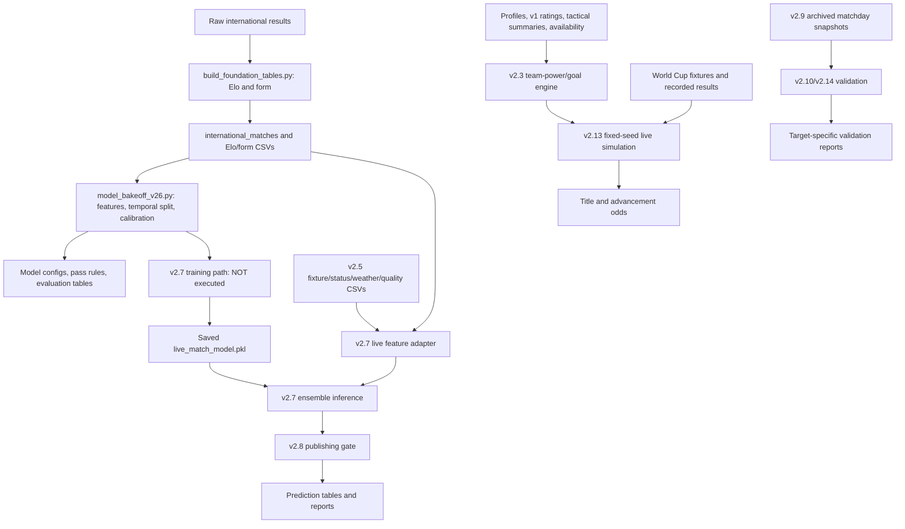

# Dependency and safe-execution map

Static detail: `capture_2026-10-20/script_dependency_map.json` records imports, functions, file literals, URLs and I/O/fit call sites for every original Python file. Static literals are not proof of executed edges. `RUNTIME_DEPENDENCIES.json` and captured audit traces record actual attempted reads/writes for exercised paths; nonexistent pycache probes are separated from existing files.

## Components inspected but not run

- Foundation builders overwrite international/Elo/form and other processed tables; their mains were not executed.
- v1/v2/v2.1/v2.2/v2.3 builders implement successive hand-weighted strength/goal/simulation research models; no full rebuild was attempted.
- `model_bakeoff_v26.py` fits Logistic Regression, Random Forest and Gradient Boosting and compares Elo/Poisson-lite/ensemble probabilities. Only read-only feature/split reconstruction was exercised, not fitting.
- v2.7 would train if its artifact were absent or `--force-train` were supplied. Audit launcher required the artifact and never supplied that flag; model hashes were verified unchanged.
- v2.5/API/weather and international-slate jobs can contact providers and write caches/tables. No live/provider/download job was executed.
- v2.11/v2.12 are shadow confidence/lineup challengers; tests exercise helpers but their full data-producing mains were not run.
- StatsBomb downloader and player-squad fetcher were not run. Missing events prevent a complete offline raw-event rebuild.

## Actual run edges

### build_confidence_gate_v28.py

Verified reads:

- `data/processed/ad_hoc_v27_june10_predictions.csv`
- `data/processed/model_v26_test_predictions.csv`
- `data/processed/v27_known_fixture_validation.csv`
- `data/processed/v27_live_public_picks.csv`

Writes in isolated copy only:

- `data/processed/ad_hoc_v28_june10_predictions.csv`
- `data/processed/confidence_gate_v28_historical_metrics.csv`
- `data/processed/v28_known_fixture_validation.csv`
- `data/processed/v28_live_public_picks.csv`
- `outputs/confidence_gate_v28_config.json`
- `outputs/confidence_gate_v28_report.md`

### build_live_predictions_v27.py

Verified reads:

- `data/model_artifacts/v27/live_match_model.pkl`
- `data/processed/team_elo_latest.csv`
- `data/processed/team_recent_form_latest.csv`
- `data/processed/v25_data_quality_live.csv`
- `data/processed/v25_fixtures_live.csv`
- `data/processed/v25_match_predictions_live.csv`
- `data/processed/v25_provider_status_live.csv`
- `data/processed/v25_weather_context_live.csv`

Writes in isolated copy only:

- `data/processed/v27_live_model_features.csv`
- `data/processed/v27_live_probabilities.csv`
- `data/processed/v27_live_public_picks.csv`
- `data/processed/v27_v25_comparison.csv`
- `outputs/live_predictions_v27_config.json`
- `outputs/live_predictions_v27_report.md`

### simulate_live_tournament_v213.py

Verified reads:

- `data/inputs/model_v21_team_profiles.csv`
- `data/inputs/player_availability_overrides.csv`
- `data/processed/matchday_validation_v210.csv`
- `data/processed/model_v1_team_ratings.csv`
- `data/processed/model_v23_tournament_odds.csv`
- `data/processed/statsbomb_team_event_summary.csv`
- `data/processed/worldcup_2026_knockout_results_verified.csv`
- `data/processed/worldcup_2026_matches.csv`
- `data/processed/worldcup_2026_round_of_32_resolved.csv`
- `data/processed/worldcup_2026_teams.csv`

Writes in isolated copy only:

- `data/processed/live_tournament_v213_tournament_odds.csv`
- `data/processed/model_v23_market_priors.csv`
- `outputs/live_tournament_v213_config.json`
- `outputs/live_tournament_v213_report.md`

### validate_worldcup_full_v214.py

Verified reads:

- `data/processed/matchday_validation_v210.csv`
- `data/processed/model_v23_group_match_predictions.csv`
- `data/processed/worldcup_2026_knockout_results_verified.csv`
- `data/processed/worldcup_2026_matches.csv`
- `data/processed/worldcup_knockout_advancement_predictions_frozen.csv`

Writes in isolated copy only:

- `data/processed/worldcup_full_validation_fixture_audit_2026-07-19.csv`
- `data/processed/worldcup_full_validation_summary_2026-07-19.csv`
- `outputs/worldcup_full_validation_report_2026-07-19.md`

