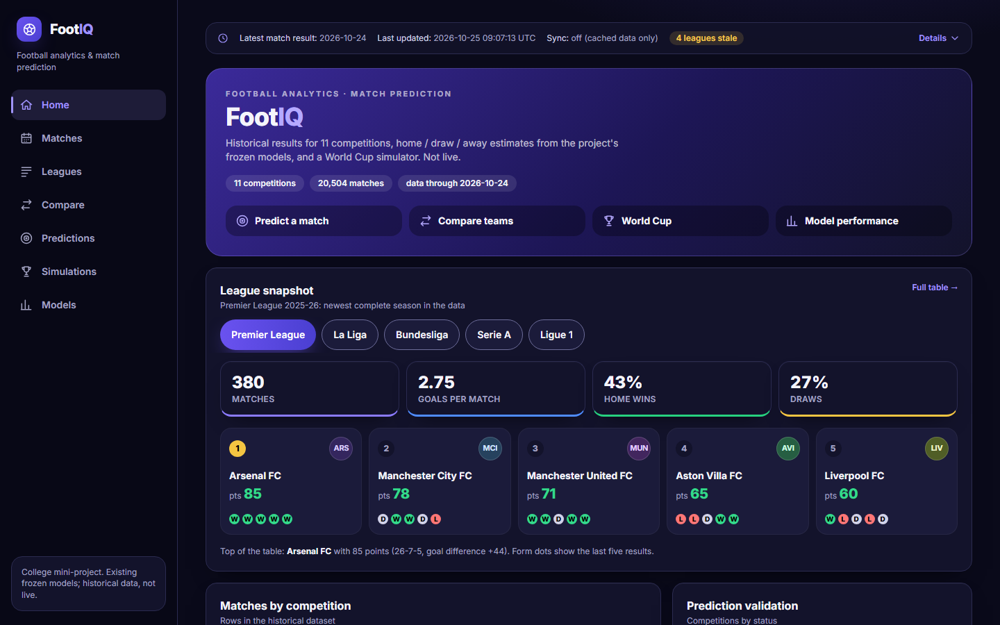
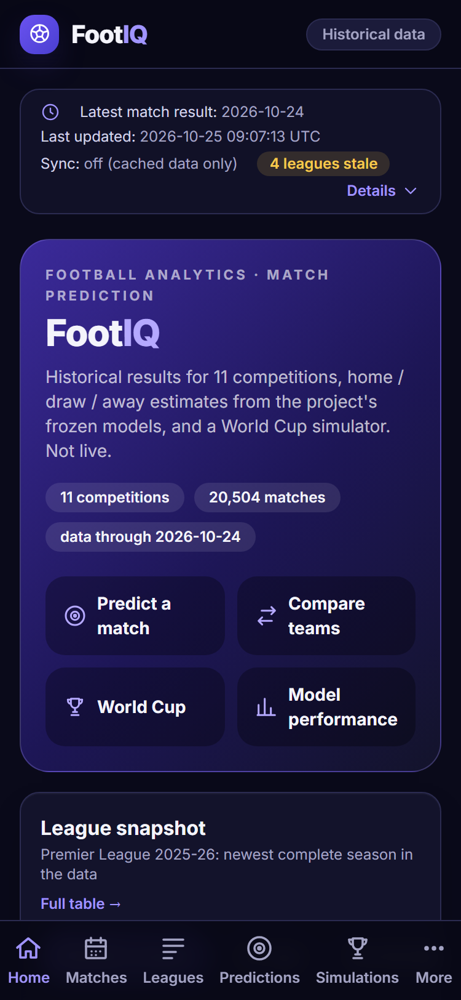

# Phase 4, stages P4.0 and P4.1: technical implementation report (checkpoint 1)

Written 2026-10-26 and 2026-10-27 on branch `feat/club-ml-v2` (HEAD `970f461`). Plan and decisions: [PHASE4_UI_AUDIT_AND_PLAN.md](../PHASE4_UI_AUDIT_AND_PLAN.md). Recovery procedure: [RECOVERY.md](RECOVERY.md).

**Stopped here for your review.** P4.2 and later stages have not been started. Nothing was staged, committed or pushed (`git diff --cached` is empty, HEAD is unchanged, `frontend/` is still untracked). No frozen model, official prospective-evaluation file, football data file, backend source or sync setting was touched (§5.5).

## 1. Status

| Stage | State |
|---|---|
| P4.0 Baseline and recovery | **Done.** Snapshot of the 45 frontend files, verified two independent ways; recovery procedure written and drilled; baseline run 65/65 tests |
| P4.1 Design system and shell | **Done.** Tokens, Inter, shared components, TeamCrest, navigation shell, accessibility fixes, tests, build, measurements, screenshots |
| P4.2 to P4.7 | Not started (waiting for your approval of this checkpoint) |

## 2. P4.0: baseline and recovery

| Item | Result |
|---|---|
| Snapshot | `data/supervised/phase4/baseline/frontend_baseline.zip`: 45 files, 369,035 bytes (zip 115,502 bytes, SHA-256 `542320c6…682aa7`), manifest with per-file SHA-256. `node_modules/` and `dist/` are excluded (rebuilt from `package-lock.json`) |
| Verification | Tool `verify`: all 45 files match; independent PowerShell `Expand-Archive` + `Get-FileHash`: 45 checked, 0 problems, zip hash equal |
| Recovery drill (on scratch copies, never the real `frontend/`) | damage drill (edit, delete, add) found by `diff` and repaired by `restore-file`; whole-frontend drill (set aside, `restore`, `npm ci` 159 packages in 14 s, build 2.1 s, **65/65 tests incl. 9 live-contract tests**, `diff` clean). Refusals confirmed: non-empty target, overwrite of the baseline, file that is not in the baseline |
| Baseline run | 65/65 (5 files) in 24 s against the backend on a private copy of the production store. The baseline log shows a React warning (two table columns both headed "Acc." and "Log loss" share a key); fixed in P4.1 |
| Protected-state record | `data/supervised/phase4/start_manifest.json`: SHA-256 of 17 protected files (production store, original CSV, sync settings, frozen models, prospective-evaluation files) and of 71 backend sources, taken before the first edit; identical to the end-of-Phase-3 manifest |

## 3. P4.1: what was built

### 3.1 Design tokens (`frontend/src/index.css`, one `@theme static` block)

| Family | Tokens (value) | Use |
|---|---|---|
| Surfaces | `bg` #0a0a1a, `sidebar` #080816, `panel` #13132b, `panel-2` #1b1b3a, `panel-3` #242448 | page, sidebar, cards, control fills, hover |
| Borders | `line` #2b2b50 (decoration), `line-strong` #6d6d9a (anything you operate) | dividers; edges of inputs, selects, outlined buttons |
| Text | `ink` #f4f4fb, `ink-2` #d2d2e8, `mute` #a4a4c4, `mute-2` #8c8cae | body, secondary, quiet, hints and placeholders |
| Brand | `accent` #a094ff (text, icons, focus ring), `accent-strong` #8b7bff, `primary` #5b47e0 / `primary-hi` #6a52f0 / `primary-lo` #4a3fd1 (solid action fills), `on-primary` #ffffff | links, active states; buttons and selected pills |
| Status | `ok` #34d98b, `warn` #f6c94c, `bad` #ff7676, `info` #82b0ff | notices, chips, badges (`info` is now violet-blue; it was green) |
| Outcomes | `home` #27d17f, `draw` #f4c542, `away` #ff6b6b | probability bars, unchanged until P4.3 |
| Shape and font | radii `control` 12 px and `card` 16 px, shadows `card` and `glow`, `--font-sans` "Inter Variable" | |

Old names (`pitch`, `pitch-dim`) still resolve, to the new tokens, so screens that are restyled later do not break. Charts take their colours from the same variables (`lib/chart.js`), so one edit recolours them.

### 3.2 Typography: Inter, self-hosted

`@fontsource-variable/inter` 5.3.0 (licence OFL-1.1; the licence file is in the package and a test reads it), imported in `main.jsx`; weight axis 100 to 900. The build emits 7 unicode-range subsets (218 kB on disk); the browser downloads only the ones a page needs. Measured in Chrome: `/` loads `inter-latin-wght-normal.woff2` (48.6 kB); Europa League club names also load `latin-ext` (85.4 kB). **Hosts contacted on the four pages checked (Home, La Liga, Europa League, Models): `localhost:5173` and `127.0.0.1:8000` only.** No external font or CDN host appears in `index.html`, any stylesheet or script in `src/`, or `dist/` (a test and a search of `dist/` both confirm).

### 3.3 Shared components (`components/ui.jsx` and new files)

All earlier exports keep their names and props, so no page needed a change for the restyle. Changes:

| Component | Change |
|---|---|
| Button | Primary is a violet gradient with white text at **5.15:1 and 7.18:1** (was 3.86:1 and 3.22:1); 44 px minimum height and width; `type="button"` by default (no form exists in the app); `ghost` and new `secondary` have a visible edge. New `ButtonLink` for navigation that looks like a button |
| Select, Input and the page-level selects | 44 px high; edge `line-strong` 3.72:1 on a card (was 1.28:1); accent edge on hover and focus; one shared `CONTROL_EDGE` class string also used by `CompetitionSelect`, `TeamPool` and the Season and Gameweek selects (class changes only, no logic) |
| Pills (single-choice filter) | `radiogroup`; only the selected pill is a Tab stop; arrow keys, Home and End move and select; 44 px |
| Tabs | `tablist`; selected tab is the Tab stop; arrow keys, Home and End move focus, Enter or Space opens (manual activation, see §7); 44 px; focus ring drawn inside the tab so the scrolling strip cannot clip it; ids on every tab; optional `idBase` adds `aria-controls`. New `TabPanel` |
| Notice | icon plus tone-coloured title; body text in `ink-2`; roles unchanged (`alert` for `bad`, `note` otherwise) |
| Badge, new Chip | 12 px; `Chip` moved here from `FixtureCard` |
| Card, SectionCard, Kpi, StatCard, MatchRow, DataTable | token colours, 16 px radius, 12 px minimum text; `DataTable` keys include the column index (fixes the duplicate-key warning); `th scope="col"` |
| FormDots, FormChips | colours from tokens; `FormDots` is one labelled image whose letters are hidden from assistive technology (its label already says the results) |
| CompareRow, Gauge | colours from tokens |
| ErrorBox, Spinner, Empty | 44 px retry button; tokens |
| Icon | extracted to `Icon.jsx`; set extended from 7 to 15 icons (home, calendar, table, compare, target, trophy, chart, more, chevron, close, check, info, alert, clock, ball), drawn for the project |
| SyncStatus | same texts and structure (the existing freshness tests pass unchanged), restyled as a compact bar with a clock icon, 44 px toggle |

### 3.4 Team badges (`TeamCrest`, `lib/team.js`, `lib/crests.js`)

* **Letters**: club prefixes ("FC", "AS", "VfB", "TSV"…), particles ("de", "d'") and purely numeric words ("05", "1860") are dropped; then one word gives its first three letters, two words give first letter + first two of the second, three or more give the first letters of the first three (`Manchester City` MCI, `Paris Saint-Germain` PSG, `1. FC Köln` KOL, `Bayer 04 Leverkusen` BLE). Always letters, upper case, never digits or punctuation. Badges under 30 px use two letters (MC). The old function returned (run on the baseline code): `Brighton & Hove Albion` **B&**, `1. FC Köln` **1K**, `1. FSV Mainz 05` **1M**, `Bayer 04 Leverkusen` **B0**, `Paderborn 07` **P0**, `Hannover 96` **H9**, `TSV 1860 München` **T1**, `1. FC Union Berlin` **1U**.
* **Colours**: FNV-1a hash of the same normalised name into 24 evenly spaced hues at fixed saturation and lightness; "Arsenal", "Arsenal FC" and "ARSENAL" get the same colour; every one of the 24 hues gives at least 4.5:1 between letters and badge (tested).
* **Real data** (read-only requests to the backend on the private copy): 422 distinct team names in the 11 competitions; 0 codes with digits, 0 empty; the only two-letter code is the club "AZ"; in the newest season of each of the five domestic leagues every team has a different three-letter code (EPL 20, La Liga 20, Bundesliga 18, Serie A 20, Ligue 1 18). Across all seasons a league has up to 2 clashes (for example Cardiff City / Coventry City both CCI); two clubs of a league often share one of the 24 colours (5 to 6 shared hues among 18 to 20 clubs), which is why the name is always written next to the badge. Both facts are asserted by `tests/crest-live.test.js` when the backend is running.
* **Licensed crests**: none exist and none is bundled, downloaded or hotlinked. `src/data/crests.json` (empty, schema 1) plus `src/assets/crests/` (empty, with a README) is the only way one can appear: an entry needs `file`, `licence` and `source`, the file must exist, and the key must be the canonical lower-case name; a bad entry is ignored and reported by the tests; entries with an `attribution` are added to the footer. A failed image load falls back to the generated badge. `TeamCrest` makes no network request (tested).

### 3.5 Navigation and shell

| Width | Navigation |
|---|---|
| 1024 px and up | full sidebar, 256 px: logo, seven destinations (icon beside label), data note |
| 768 to 1023 px | rail, 88 px: logo mark, seven destinations (icon above label; "Simulations" is 67.7 px wide at 12 px and fits the 72 px inside the rail) |
| below 768 px | top bar (logo, "Historical data" chip) and a bottom bar: five primary destinations (Home, Matches, Leagues, Predictions, Simulations) plus **More**, which opens a modal sheet with Compare and Models |

All seven destinations are reachable at every width (tested for the phone: bar plus sheet equals the seven addresses). Defined once in `lib/nav.js`; the sidebar and bars read it.

* **Bottom bar fit** (measured in Chrome with Inter): at 12 px and weight 600 the labels are Home 34.2, Matches 50.1, Leagues 49.4, Predictions 65.6, Simulations 67.7, More 30.0 px. Six equal columns at 375 px are 62.5 px, so "Predictions" and "Simulations" overlapped by 4 px (first attempt, seen in a screenshot). Cells are now sized by their label and share the spare width: at 375 px cells are 46.9 to 80.5 px wide and 64 px tall with 12.8 to 13.4 px between labels; at 360 px at least 9.8 px; no horizontal overflow at 375, 360 and 342 px.
* **More sheet**: `role="dialog"`, `aria-modal`, named "More"; focus moves to its first control; Tab and Shift+Tab stay inside; Escape, the close button, the backdrop and choosing a destination close it; focus returns to the More button (not after choosing a destination); the page behind does not scroll; the bar's More button shows `aria-expanded` and is highlighted while a More destination is the current page.
* **Per navigation**: tab title `<Page> · FootIQ` (for example "Leagues · FootIQ"; it was "FootIQ - Football Analytics" on every route); a polite live region announces the page; the window scrolls to the top; focus moves to the page area (`<main id="main" tabindex="-1">`), but only when the path changes, not for query changes. First Tab stop on every page is **Skip to main content** (visible on focus, 180 x 44 px at the top left); activating it focuses the page area and leaves the URL unchanged.
* `prefers-reduced-motion` switches animations and transitions off; `color-scheme: dark`; headings use balanced wrapping.

### 3.6 Routes

| Address | Result |
|---|---|
| `/`, `/analytics`, `/compare`, `/predict`, `/simulations`, `/worldcup`, `/models` | unchanged addresses and pages (`/worldcup` still shows Simulations and highlights it) |
| `/predictions` | **new**: redirects to `/predict` keeping the whole query (`/predictions?comp=EPL&mode=manual` becomes `/predict?comp=EPL&mode=manual`) |
| `/matches` | **new**, interim: heading "Matches", a note "Not built yet.", and links "Open Predictions" and "Open Leagues". It shows no match, score or date of its own (tested). The hub itself is P4.3 |
| unknown address | heading "Page not found" and a link home (was a bare paragraph) |
| `/design` | development server only: tokens and components on one page (`/design?only=controls` shows one section). Absent from the production build (search of `dist/` finds nothing) |

### 3.7 What did not change

No API call was added or removed (`lib/api.js` and `lib/hooks.js` are byte-identical; no page's data code changed). No prediction, simulation, eligibility or freshness logic changed. The Predictions and Simulations pages gained only a tab-to-panel link (a wrapper element) and the Analytics and Gameweek pages only class names on their selects. The World Cup simulator, the points-only and position-range simulations, the explicit-action buttons, the freshness bar and the provisional flags are intact; their tests pass unchanged.

## 4. Files changed

Frontend only. Backend, configuration, data and models: none. All six existing test files are **byte-identical** to the baseline.

**Changed (22):** `README.md` (+29 −14; it was stale: 39 tests, no Season simulator row), `package.json` (+1), `package-lock.json` (+10; one package added), `src/index.css` (+141 −27), `src/main.jsx` (+1), `src/App.jsx` (+36 −14), `src/components/ui.jsx` (+177 −126), `Layout.jsx` (+55 −54), `SyncStatus.jsx` (+30 −25), `FixtureCard.jsx` (+5 −12), `PageHeader.jsx` (+3 −3), `ProbBar.jsx`, `SourceDetails.jsx` (+1 −1 each), `Bracket.jsx` (+2 −2), `CompetitionSelect.jsx` (+2 −1), `TeamPool.jsx` (+2 −1), `src/lib/chart.js` (+17 −6), `src/lib/team.js` (+59 −11), `src/pages/Predictions.jsx` (+5 −2), `Simulations.jsx` (+4 −3), `Analytics.jsx` (+2 −2), `GameweekPredict.jsx` (+3 −3).

**Added (16):** `src/components/Brand.jsx`, `Icon.jsx`, `MobileNav.jsx`, `Sidebar.jsx`, `TeamCrest.jsx`; `src/lib/contrast.js`, `crests.js`, `nav.js`; `src/data/crests.json`; `src/assets/crests/README.md`; `src/pages/DesignSystem.jsx`, `Matches.jsx`; `tests/design-tokens.test.js`, `crest.test.jsx`, `crest-live.test.js`, `shell.test.jsx`.

**Dependency change:** one runtime dependency, `@fontsource-variable/inter` ^5.3.0 (the lockfile gains exactly that package; dev dependencies are identical).

**Outside `frontend/`:** this report, `RECOVERY.md`, the screenshots and probe results in `docs/mini-project/phase4/`, and the git-ignored tools, snapshot and logs in `data/supervised/phase4/` (`frontend_snapshot.py`, `phase4_integrity.py`, `tools/*.mjs`).

## 5. Verification

### 5.1 Frontend tests

| File | Tests | Origin |
|---|---|---|
| `app.test.jsx` | 17 | existing, unchanged |
| `redesign.test.jsx` | 14 | existing, unchanged |
| `gameweek.test.jsx` | 8 | existing, unchanged |
| `season.test.jsx` | 17 | existing, unchanged |
| `live-api.test.js` | 9 | existing, unchanged (live backend) |
| `design-tokens.test.js` | 67 | new: every text, status, tint, button, edge and focus-ring pair against WCAG; every `var(--color-…)` in `src` is a defined token; no text under 12 px or hard-coded colour in the redesigned components; no external font host; font licence present |
| `crest.test.jsx` | 43 | new: 23 name cases (including every one that used to produce digits), accent, case and prefix independence, 24-hue contrast, `TeamCrest` rendering, licensed-image path and fallback, no network, manifest rules |
| `shell.test.jsx` | 40 | new: seven destinations and five primary, addresses kept, active state, More sheet (open, Escape, focus return, Tab trap, backdrop, choose), titles for ten routes, skip link, focus and announcement after navigation, `/predictions` redirect with query, `/worldcup`, Matches placeholder, 404, tab and filter keyboard behaviour, panel links, `DataTable` keys, button type and height |
| `crest-live.test.js` | 2 | new (live backend): every real team name, and distinct codes inside each league's newest season |

**Results.** 2026-10-26 evening, after the last source change: **217 of 217 pass with the live backend** (`FOOTIQ_LIVE_API=http://127.0.0.1:8000 npx vitest run --no-file-parallelism`). Final runs on 2026-10-27, with the last test edit: **206 pass and 11 are skipped without the backend (two consecutive runs)**; with the backend, 216 pass and one fails on its 5 s timeout, the unchanged live test "gameweek endpoints": `/api/gameweek` took 10.5 s today against about 3.7 s yesterday. `app/` is byte-identical, so it is not a code change; the machine was busier (CPU load 33%, another Python server and several browsers running), which is the likely reason, but I did not isolate it. Run with `--testTimeout=40000` (no file changed) **all 9 live contract tests pass**, that one in 10.7 s, and the 2 live badge tests pass. This slowness matters for P4.2: the Home banner must not call `/api/gameweek` (decision 3).

Two existing gameweek tests failed once during development: a panel named "Gameweek" next to a control named "Gameweek" made their label query ambiguous. The tests were not changed; the panel was given its own name (§7).

### 5.2 Production build

`npm run build`: 635 modules, no warnings. Sizes against a clean baseline build (built outside the git-ignored folder, see §9):

| | Baseline | P4.1 | Change |
|---|---|---|---|
| JavaScript, all chunks | 805.62 kB (247.01 kB gzip) | 820.04 kB (252.80 kB gzip) | +14.42 kB (+5.79 gzip) |
| CSS | 39.64 kB (7.78 kB gzip) | 47.77 kB (9.46 kB gzip) | +8.13 kB (+1.68 gzip) |
| JavaScript + CSS, gzip | 254.79 kB | 262.26 kB | **+7.47 kB (+2.9%)** |
| Fonts | none (Inter was named but never loaded) | 7 subset files, 218 kB on disk; 48.6 kB downloaded for English text | +48.6 kB on first visit, then cached |

The shared components now form their own chunk (`ui-*.js`, 66.3 kB, 23.4 kB gzip); the main chunk fell from 283 kB to 230 kB. `DesignSystem` and `contrast.js` are not in `dist/`.

### 5.3 Measurements in a real browser

Headless Chrome 156 against the dev server and the backend on a private database copy, same probe on the untouched baseline and on P4.1 (`probe-baseline.json`, `probe-p41.json` in [p4.1/](p4.1/)). 7 routes × 3 widths (1440, 820, 375 px). "Read text" excludes decorative `aria-hidden` letters (badge initials, W/D/L dots), which are 11 px.

**Summary over the seven routes at 1440 px:** controls smaller than 44 px **114 → 28**; text smaller than 12 px that people read **75 → 3**; text contrast failures **0 → 0** (gradient backgrounds are checked by the token tests instead); horizontal overflow **none → none** at all three widths; document titles **1 distinct → 7 distinct**; every route has exactly one `h1` (Matches had none because the route did not exist).

| Route (1440 px) | Title after | Controls < 44 px before → after | Read text < 12 px before → after |
|---|---|---|---|
| `/` Home | "Home · FootIQ" | 37 of 41 → 25 of 43 | 48 → 1 |
| `/matches` | "Matches · FootIQ" | (no route) → 0 of 11 | – |
| `/analytics` Leagues | "Leagues · FootIQ" | 11 of 12 → 0 of 14 | 5 → 0 |
| `/compare` | "Compare · FootIQ" | 10 of 11 → 0 of 13 | 3 → 2 |
| `/predict` Predictions | "Predictions · FootIQ" | 23 of 25 → 0 of 27 | 6 → 0 |
| `/simulations` | "Simulations · FootIQ" | 16 of 16 → 2 of 18 | 3 → 0 |
| `/models` | "Models · FootIQ" | 10 of 10 → 1 of 12 | 9 → 0 |

At 375 px the controls below 44 px are 30 → 25 (Home), 4 → 0 (Leagues), 3 → 0 (Compare), 16 → 0 (Predictions), 9 → 2 (Simulations), 3 → 1 (Models); the 820 px figures are in the JSON. The 28 that remain are listed in §8.

Charts: Recharts now reads its colours from CSS variables. On each chart screen every variable-coloured element resolved to a real colour (Home 48 uses, Leagues > Stats 59, Models 46, a World Cup run 64; 0 unresolved), and the four screens were checked by eye ([charts-home](p4.1/charts-home.png), [charts-leagues-stats](p4.1/charts-leagues-stats.png), [charts-models](p4.1/charts-models.png), [charts-simulator](p4.1/charts-simulator.png)). Chart text went from 11 to 12 px.

### 5.4 Keyboard checks in a real browser (real key events)

* First twelve Tab stops on Home at 1440 px: Skip to main content, FootIQ home, Home, Matches, Leagues, Compare, Predictions, Simulations, Models, the data-freshness button, "Predict a match", "Compare teams". The phone's bottom bar and top bar are `display: none` at this width and are not in the order.
* Skip link: focused at (12, 12), 180 x 44 px; Enter leaves focus on `main#main` and the URL unchanged.
* Phone width: Enter on More opens the dialog, focus on "Close menu", `aria-expanded="true"`; Escape closes it and focus is back on More.
* Clicking Leagues in the sidebar: title "Leagues · FootIQ", focus on `main#main`, live region says "Leagues".
* Keyboard focus ring on a sidebar item: [keyboard-focus-ring-sidebar.png](p4.1/keyboard-focus-ring-sidebar.png).

### 5.5 Backend tests and integrity checks

* Backend sources, configuration and tests are byte-identical to the state recorded before P4.1 (71 files), so the backend suite cannot differ from the Phase 3 result (182 passed). Full backend suite re-run after the last frontend source change: **182 passed, 1 warning in 15 min 6 s, exit code 0** (the warning is a Starlette notice about `httpx` in `fastapi.testclient`, present before this stage; log `data/supervised/phase4/p41_backend_pytest.log`).
* `python data/supervised/phase4/phase4_integrity.py check` (after the last frontend change):

| Check | Result |
|---|---|
| Six frozen files in `hashes_before.json` | unchanged |
| 17 protected files (production store, original CSV, sync settings, frozen models, 6 prospective-evaluation files) | identical to the start of Phase 4 **and** to the end of Phase 3 |
| 71 backend sources (`app`, `app/store`, `app/seasonsim`, `app/static`, `config`, `tests`) | identical to the start of Phase 4 |
| Production store | SHA-256 equals the post-import record; `integrity_check` ok; `simulation_runs` 0 |
| Settings | `live_enabled` false; `scoreline_method` null (validation `failed_predeclared_criteria`); position bounds enabled, as before |
| Git | 0 staged files; HEAD `970f461` unchanged; 0 files under `frontend/` tracked |

All browser, test and measurement runs used a private copy of the production store (`data/supervised/rehearsal/phase4_ui.sqlite`, made with the read-only copy routine). Nobody pressed Predict gameweek or any other button that writes. The private copy and the scratch folders of this stage were deleted after the final runs, and the integrity check above was repeated afterwards with the same result.

### 5.6 Contrast (computed from the real tokens)

| Pair | Ratio | Required |
|---|---|---|
| ink / ink-2 / mute on panel | 16.60 / 12.22 / 7.52:1 | 4.5:1 |
| mute-2 on panel-2 (placeholders, disabled text); on panel-3 (lowest pair tested) | 5.12:1; 4.56:1 | 4.5:1 |
| accent on panel | 7.07:1 | 4.5:1 |
| ok / warn / bad / info on panel | 9.90 / 11.58 / 7.01 / 8.31:1 | 4.5:1 |
| bad on its own 15% tint over a card (lowest status tint) | 5.63:1 | 4.5:1 |
| white on `primary-hi` and `primary-lo` (button gradient ends) | 5.15 and 7.18:1 (**before 3.86 and 3.22**) | 4.5:1 |
| control edge `line-strong` on panel; on the control's own fill | 3.72:1; 3.40:1 (**before 1.28:1**) | 3:1 |
| focus ring (accent) on panel | 7.07:1 | 3:1 |
| active navigation item (accent on a 15% accent tint over the sidebar) | 6.33:1 | 4.5:1 |
| old placeholder (`mute` at 60%) on panel | 3.22:1 before; `mute-2` 5.12:1 now | 4.5:1 |

## 6. Screenshots

Captured with headless Chrome 156 against the running app and the backend on the private copy: desktop 1440 x 900 and tablet 820 x 1180 at 1x, phone 375 x 812 at 2x. "Before" is the untouched baseline.

| View | Before | After |
|---|---|---|
| Desktop, Home | [before](p4.1/before/desktop-home.png) | [after](p4.1/desktop-home.png) |
| Desktop, Leagues table | [before](p4.1/before/desktop-leagues-table.png) | [after](p4.1/desktop-leagues-table.png) |
| Desktop, Predictions (gameweek) | [before](p4.1/before/desktop-predictions.png) | [after](p4.1/desktop-predictions.png) |
| Desktop, Models | [before](p4.1/before/desktop-models.png) | [after](p4.1/desktop-models.png) |
| Desktop, Matches (new), Compare, Simulations | – | [matches](p4.1/desktop-matches.png), [compare](p4.1/desktop-compare.png), [simulations](p4.1/desktop-simulations.png) |
| Tablet, Home (rail) | [before](p4.1/before/tablet-home.png) | [after](p4.1/tablet-home.png) |
| Tablet, Leagues and Predictions | – | [leagues](p4.1/tablet-leagues-table.png), [predictions](p4.1/tablet-predictions.png) |
| Phone, Home (bottom bar) | [before](p4.1/before/mobile-home.png) | [after](p4.1/mobile-home.png) |
| Phone, Predictions | [before](p4.1/before/mobile-predictions.png) | [after](p4.1/mobile-predictions.png) |
| Phone, Models; More sheet | – | [models](p4.1/mobile-models.png), [More sheet](p4.1/mobile-more-sheet.png) |
| Keyboard | – | [skip link](p4.1/keyboard-skip-link.png), [focus ring](p4.1/keyboard-focus-ring-sidebar.png) |
| Design system (development page) | – | [tokens](p4.1/design-tokens.png), [controls](p4.1/design-controls.png), [badges, notices, states](p4.1/design-states.png), [team badges](p4.1/design-badges.png) |





## 7. Decisions and deviations for your review

1. **Visual direction.** Built from the dark-purple dashboard described in `UPGRADE_PLAN.md` §6 (sidebar, spacious cards, violet accents). The reference image itself is not stored anywhere, so this is the provisional direction you approved; the screenshots are the approval material.
2. **`/matches` exists before its hub.** The approved navigation has seven destinations including Matches, so the route exists now as an honest placeholder (no invented content). If you would rather have the item appear only when P4.3 lands, it is one line in `lib/nav.js`.
3. **Bottom bar = five primary items plus More = six controls.** I read "five primary items plus a More menu" literally. Equal columns do not fit the label widths (§3.5), so cells are label-sized. The alternative is four primary items plus More (equal 75 px columns); say so if you prefer it.
4. **Tabs use manual activation** (arrows move focus, Enter or Space opens), because some panels fetch data (the gameweek list takes about 4 s); filters (Pills) select on arrow keys. Standard ARIA allows both.
5. **Panel names.** The Predictions panel is named "Gameweek predictions" (not by its tab) because "Gameweek" is also the name of the select inside it, which the existing `gameweek.test.jsx` queries by label. Simulations uses the tab's name.
6. **`info` is now violet-blue, not green.** It changes the look of every existing info notice (for example "Pre-tournament mode." on the World Cup page) while keeping their text and role.
7. **Existing copy kept where a test pins it:** "1 leagues stale" (grammar) stays until P4.2 because `redesign.test.jsx` asserts that exact text.
8. **Decorative letters stay at 11 px.** Badge initials and W/D/L dots are `aria-hidden` and sit beside the written team name or a labelled group; they are excluded from the 12 px rule and counted separately in the measurements.
9. **Page-level class changes beyond the shared components:** the selects in `Analytics.jsx` and `GameweekPredict.jsx` and the two components `CompetitionSelect` and `TeamPool` got the shared control edge and height (class strings only), because the P4.1 brief includes control borders and touch targets and they would otherwise be the only low-contrast controls left in the shared layer.
10. **`/design` development page** was not on the list; it exists so you can review tokens and components in one place and is absent from the production build.
11. **`README.md` rewritten in part** (stale test count, missing Season simulator, old layout description).

## 8. Remaining items, by the stage that owns them

None of these is a behaviour problem; all are presentation inside pages that are redesigned later.

| Item (measured) | Owner |
|---|---|
| Home: 25 controls under 44 px (competition cards 36 px high, "Predict" links 24 px, "Full table →" and "See how the models were evaluated" 16 px), hero label at 11 px, "1 leagues stale" wording, two dataset charts to move to Models, y-axis labels overlapping at tablet width in the competition chart | P4.2 |
| `Predict.jsx` (6 classes at 9 to 11 px), `FixtureCard` and `ProbBar` colours, "1" and "2" labels, Matches hub | P4.3 |
| Leagues sections not linked to panels (`aria-controls`), Analytics page layout | P4.4 |
| World Cup mode radio buttons (13 px, two), `Simulator.jsx` (2) and `SeasonSimulator.jsx` (18 classes at 9 to 11 px), inner tab strips not yet linked to panels | P4.5 |
| Compare ("Team A" and "Team B" at 11 px, `TeamComparison.jsx` 3 classes), Models (`<summary>` 16 px high, evaluation tabs not linked to panels) | P4.6 unless you want them earlier |
| Full WCAG pass with states (errors, empty, loading) at all three widths | P4.6 |

## 9. Corrections made during this stage

* **Baseline CSS size.** The first recovery note gave the baseline stylesheet as 71.12 kB. That build ran inside `data/supervised/`, which git ignores; Tailwind 4 reads the ignore rules when it looks for class names and, there, emitted 528 classes that exist nowhere in FootIQ (for example `mask-radial-*`). Built outside the ignored folder the same files give 39.64 kB. `RECOVERY.md` is corrected and warns to build restored copies elsewhere. All sizes in §5.2 use the clean figure.
* **A fragile wait in my own test.** `shell.test.jsx` > "redirects /predictions to /predict…" failed 3 of 3 times on 2026-10-27: it waited the default 1 s for the lazily loaded Predictions page, whose first import pulls in Recharts and takes just over a second on a cold start (it had passed the day before). The redirect itself was fine (it is also confirmed in a real browser). All lazy-route waits in that file are now 10 s; 40 of 40 pass on every run since.
* **A tab strip and a badge size seen in the first screenshots** were fixed before the final capture: the underline ran 16 px past the content on tablet and desktop, and three-letter badges looked cramped.
* **An Enter key in my own browser driver** did not open the More sheet because the synthetic key event produced no `keypress`; the driver was fixed (the app was correct: a real click and the corrected key event both open it).

## 10. Reproduce

```bash
# frontend tests (backend on a private copy of the store: FOOTIQ_STORE_PATH=<copy> python -m uvicorn main:app --app-dir app --port 8000)
cd frontend && FOOTIQ_LIVE_API=http://127.0.0.1:8000 npx vitest run --no-file-parallelism
npm run build

# what changed since the baseline, and integrity
.venv/Scripts/python.exe -X utf8 data/supervised/phase4/frontend_snapshot.py diff
.venv/Scripts/python.exe -X utf8 data/supervised/phase4/phase4_integrity.py check

# screenshots, measurements, keyboard checks (dev server on 5173, backend on 8000; headless Chrome)
node data/supervised/phase4/tools/p41_capture.mjs shots      # or: probe | keys
node data/supervised/phase4/tools/charts_check.mjs
```
